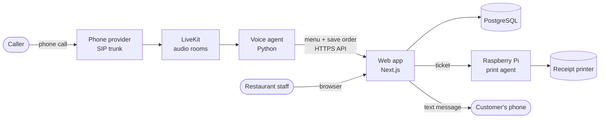

# Quick Assistant

**An open-source AI assistant that answers a restaurant's phone and takes orders. You run it on your own server.**

A customer calls the restaurant. The assistant greets them, takes the order (dish options, pickup time, read-back), saves it, and the
kitchen's receipt printer prints the ticket. Staff watch orders arrive live on a web dashboard. One installation can serve any number of
restaurants, fully isolated from each other. You own the stack (server, database, phone numbers, API keys): no per-order fees, no lock-in.

**Where to start**

| I am... | Go to |
|---|---|
| Curious how it works | [How it works](#how-it-works) |
| A developer who wants it running on my laptop | [Run it locally](#run-it-locally-developers) |
| A restaurant (or its IT helper) who wants to use it | [Deploy it for your restaurant](#deploy-it-for-your-restaurant) |
| Changing the code | [Contributing](#contributing) and [CLAUDE.md](CLAUDE.md) |

---

## How it works

### The pieces



| Piece | What it does | Where it lives |
|---|---|---|
| **Web app** | The dashboard (orders board, menu, settings), the platform admin pages, and the internal API the voice agent uses. All rules live here. | `apps/web` |
| **Voice agent** | Joins each call, listens (Deepgram), thinks (OpenAI or DeepSeek), speaks. **Never touches the database**: it only calls the web API. | `apps/agent` |
| **PostgreSQL** | All data. Each restaurant's rows are locked to it by row-level security. | Docker |
| **LiveKit + SIP provider** | Turn a real phone call into an audio room the agent can join. Rented services. | Cloud |
| **Print agent** | A small Go program on a Raspberry Pi that fetches tickets and prints them. Only connects *out* to your server. | `apps/printer-agent` |

### What happens during one call

1. The customer dials the restaurant's number. The phone provider hands the call to LiveKit, which starts the voice agent.
2. The agent reads **which number was dialed**, asks the web API for that restaurant's menu and opening hours (closed? it says so and hangs up).
3. It greets the caller, says it is an automated assistant, and takes the order. Prices, names and options are checked by the server; **totals are computed in code, never by the AI**.
4. It asks for a pickup time, reads the order back once and saves it. It gives an order number, and can text the customer a link to follow it.
5. The order appears on the dashboard with a chime. If a printer is set up, the ticket prints (immediately, or when staff press **Confirm & Print**).
6. The customer can call back later to **cancel or change** the order (same phone number only, only until the kitchen starts it).

### Who uses what

- **Customers** just phone. Optionally they get texts and a public order page.
- **Restaurant owners and staff** use the dashboard: live orders, menu (categories, options, CSV import/export), sold-out toggle,
  opening hours, team, notification emails, kitchen printer. Owners manage everything; staff see orders and sold-out switches.
- **You, the platform operator** use `/admin`: create restaurants, attach each phone number, choose the AI model, block abusive numbers, read the audit log.

### Built for real use

Tenant isolation enforced by the database, idempotent orders (a retry never duplicates), abuse limits (blocked numbers, per-caller and concurrent-call caps,
call time limits), caller numbers masked in logs and purged after 90 days, queued emails and texts with retries, daily verified backups, health checks,
graceful deploys that let calls finish, an append-only audit log, and a test suite including simulated phone calls against the real model.
Details in [docs/ARCHITECTURE.md](docs/ARCHITECTURE.md).

**Stack:** Next.js 16 (TypeScript, React Suite, Tailwind), PostgreSQL 16 + Drizzle, Better Auth, Python + LiveKit Agents, Deepgram, OpenAI or DeepSeek, Go, Docker Compose, GitHub Actions.

---

## Run it locally (developers)

**You need:** Node 22+, [pnpm](https://pnpm.io), Python 3.12+ with [uv](https://docs.astral.sh/uv/), and Docker. Go is only needed for the printer agent.

### 1. Web app and database (no API keys needed)

```bash
git clone <your fork or this repo> && cd quick-assistant
cp .env.example .env
pnpm install && (cd apps/agent && uv sync)
pnpm db:up                         # PostgreSQL in Docker
pnpm --filter web db:migrate       # create the tables
pnpm dev:web                       # dashboard at http://localhost:3000
```

Open http://localhost:3000 and **sign up with an email and password**. With no email provider set, the verification link is **printed in the
terminal running `pnpm dev:web`**: open it. Then, in another terminal, create the demo restaurant ("Demo Pizza", five dishes) and make yourself its owner:

```bash
DEMO_OWNER_EMAIL=you@example.com pnpm --filter web db:seed     # use the email you signed up with; safe to re-run
```

Reload the dashboard: you now see the Demo Pizza menu, orders board and settings.

### 2. Talk to the assistant (console mode, no phone line)

Add `DEEPGRAM_API_KEY` and `OPENAI_API_KEY` (or `DEEPSEEK_API_KEY`) to `.env`, keep `pnpm dev:web` running, and in another terminal:

```bash
cd apps/agent && uv run python -m order_agent.main console
```

You speak through your computer's microphone and the agent answers through the speakers, ordering from Demo Pizza (its fake dialed number is
`DEV_CALLED_NUMBER` in `.env`). Place an order and watch it land on the orders board. Run it from `apps/agent`: it finds `.env` by relative path.

### 3. Optional extras

| To try | Do this |
|---|---|
| **Platform admin pages (`/admin`)** | Put your email in `PLATFORM_ADMIN_EMAILS`. Admins sign in with Google (`GOOGLE_CLIENT_ID/SECRET`), or on a brand-new system set `PLATFORM_ADMIN_PASSWORD` (12+ characters) and restart `dev:web` to get a password admin. |
| **Real phone calls** | A LiveKit project, a SIP number and a dispatch rule: [docs/SYSTEM_SETUP.md](docs/SYSTEM_SETUP.md) section 7. Then `pnpm dev:agent` (unset `DEV_CALLED_NUMBER`). |
| **Texts to customers** | `SMS_PROVIDER=log` prints them in the web console. |
| **Kitchen printer** | [docs/PRINTER_MANUAL.md](docs/PRINTER_MANUAL.md). Locally: `pnpm --filter web agent:build`. |
| **Database browser** | `pnpm --filter web db:studio` |

### Tests

```bash
pnpm lint
pnpm --filter web test                                   # unit, isolation, integration (needs the database, see CLAUDE.md for the env vars)
pnpm --filter web build && pnpm --filter web test:e2e    # browser tests (first: pnpm --filter web exec playwright install chromium)
cd apps/agent && uv run python -m pytest -q              # agent tests, no network
cd apps/printer-agent && go test ./...                   # printer agent
cd apps/agent && uv run python -m evals.run_evals        # simulated calls against a real LLM (paid, small)
```

### Repository map

| Path | What is in it |
|---|---|
| `apps/web` | Dashboard, platform admin, and the API the voice agent calls (`/api/agent/*`) |
| `apps/agent` | The LiveKit voice agent (`src/order_agent`) and its evals |
| `apps/printer-agent` | Go program for the Raspberry Pi |
| `docker-compose.yml` | The whole production stack in one file: web, agent, database, HTTPS entry, backups, retention |
| `scripts/` | Optional: the CI deploy script and a manual backup |
| `docs/` | Architecture, system setup, deployment, printer manual |

### Rules worth knowing before you change things

- The voice agent talks only to the web API. Validation and saving live in the route handlers.
- Every restaurant table has `tenant_id` and row-level security; use `withTenant()`. A test fails if a table forgets it.
- Every action that changes data writes an audit entry and is added to the tenant-isolation test.
- Prices and totals are computed in code. Prompt changes are checked with the evals.

---

## Deploy it for your restaurant

You will put the system on **one small Linux server** and connect a phone number to it. Plan for **an afternoon** the first time. You do not need to
write code, but you do need to be comfortable copying commands into a terminal; the guide below tells you exactly what to type. If you get stuck,
open an issue on GitHub.

### What you need before you start

| Need | Why | Cost |
|---|---|---|
| A **domain name** (e.g. `orders.myrestaurant.com`) | The dashboard's address | about $10 to $15 a year |
| An **Ubuntu 22.04/24.04 server**, 2 GB RAM | Runs everything | about $6 to $12 a month at any VPS provider (Hetzner, DigitalOcean, Lightsail...) |
| **LiveKit Cloud** account | Connects phone calls to the assistant | pay by usage, has a free tier |
| A **phone number** from Twilio, Plivo, Telnyx or LiveKit | The number customers dial | about $1 to $2 a month plus per-minute |
| **Deepgram** and **OpenAI** (or DeepSeek) API keys | Hearing and speaking, and understanding | pay by usage, cents per call |
| A **Google Cloud** OAuth client | "Sign in with Google" for the platform admin | free |
| Optional: **Resend** (email), Twilio/Plivo SMS (texts) | Order emails and customer texts | free tier / usage |
| Optional per kitchen: **Raspberry Pi + USB receipt printer** | Printed tickets | one-off, about $100 |

Set **spending alerts** at every provider before going live. The software itself is free.

### Step by step

**1. Prepare the server.** Log in over SSH, install Docker (follow [Docker's Ubuntu guide](https://docs.docker.com/engine/install/ubuntu/)), then:

```bash
sudo usermod -aG docker $USER && newgrp docker
sudo ufw allow OpenSSH && sudo ufw allow 80/tcp && sudo ufw allow 443/tcp && sudo ufw enable
```

At your domain registrar, create a DNS **A record** pointing your domain at the server's IP address. (Server at home or an office with no open
ports? Set `COMPOSE_PROFILES=tunnel` below, which needs a free Cloudflare account: see [docs/DEPLOY.md](docs/DEPLOY.md) section 0.)

**2. Create a folder with two files.** On the server:

```bash
mkdir quick-assistant && cd quick-assistant
curl -fsSLO https://raw.githubusercontent.com/dingzhanjun/quick-assistant/main/docker-compose.yml
nano .env          # paste the settings below, fill them in, save
chmod 600 .env
```

That is the whole installation: `docker-compose.yml` (the entire stack, nothing else to download) and `.env` (your settings). The `.env`:

```bash
DOMAIN=orders.myrestaurant.com          # your domain, no https://
COMPOSE_PROFILES=caddy                  # HTTPS on ports 80/443 (use "tunnel" for Cloudflare Tunnel, see docs/DEPLOY.md)
POSTGRES_PASSWORD=                      # three different secrets: run  openssl rand -hex 32  three times
BETTER_AUTH_SECRET=
AGENT_API_KEY=
PLATFORM_ADMIN_EMAILS=you@example.com   # who administers the platform
PLATFORM_ADMIN_PASSWORD=                # 12+ characters; lets you sign in before Google is set up. Delete it later
LIVEKIT_URL=wss://your-project.livekit.cloud
LIVEKIT_API_KEY=
LIVEKIT_API_SECRET=
AGENT_NAME=quick-assistant              # must match the agent name in your LiveKit dispatch rule (step 6)
DEEPGRAM_API_KEY=
OPENAI_API_KEY=                         # or DEEPSEEK_API_KEY
```

Optional settings (Google sign-in, email, texts, tuning) are all listed and explained in
[`.env.prod.example`](.env.prod.example).

**3. Start it.**

```bash
docker compose up -d
curl https://your-domain/api/health        # should answer {"ok":true}
```

This downloads the ready-made images from GitHub Container Registry (`ghcr.io/dingzhanjun/quick-assistant/web`, `/agent`, `/migrate`; public, no
login), prepares the database and starts everything: the web app, the voice agent, PostgreSQL, daily backups and HTTPS. Open
`https://your-domain` and you should see the sign-in page. Needs Docker Compose 2.23.1 or newer (`docker compose version`); a current Docker
install has it.

**4. Update later.** `docker compose pull && docker compose up -d`. The database is migrated automatically. Pin a version with `IMAGE_TAG=<tag>`
in `.env`, and roll back by setting the previous tag. Take a backup first if you like: `docker compose run --rm --no-deps backup once`.

**5. Using your own fork, or changing the code?** Fork the repository on GitHub: every push to `main` builds and publishes your own images to
`ghcr.io/<you>/<repo>` (make the three packages public once in GitHub's package settings). Then set `IMAGE_PREFIX=ghcr.io/<you>/<repo>` (lowercase)
in `.env`. Automatic deploys over SSH are an optional extra for developers: [docs/DEPLOY.md](docs/DEPLOY.md).

**6. Connect the phone number.** In LiveKit create a SIP *inbound trunk* for your number and a *dispatch rule* that sends calls to an agent
named, say, `quick-assistant`; put the same name in `AGENT_NAME` in `.env` (step 2), and run `docker compose up -d` again. Full walkthrough with
screens to look for: [docs/SYSTEM_SETUP.md](docs/SYSTEM_SETUP.md) section 7.

**7. Sign in as admin and add your restaurant.** Sign in at `https://your-domain` (Google, or the temporary admin password).
Sign up the restaurant owner (or yourself) and create the restaurant. Then in **/admin** attach the restaurant's phone number
(international format, e.g. `+14155550100`). Without this, callers hear that orders cannot be taken.
(Google sign-in setup: [docs/SYSTEM_SETUP.md](docs/SYSTEM_SETUP.md) section 5.)

**8. Set up the restaurant** (the owner does this in the dashboard):
- **Menu**: add dishes or **Import CSV**; add categories and options such as size or spice.
- **Settings**: time zone, opening hours, address, notification emails, an optional human phone line, team members.
- Email delivery needs a Resend key (`RESEND_API_KEY`, `EMAIL_FROM`); until then nobody receives verification or order emails.

**9. Make a test call.** Call the number from your mobile, order a dish, and watch it appear on the **Orders** board. If you have a printer,
set it up under **Settings, Kitchen printing**: [docs/PRINTER_MANUAL.md](docs/PRINTER_MANUAL.md), about five minutes, no monitor needed.

When it works, run through the **go-live checklist** at the end of [docs/SYSTEM_SETUP.md](docs/SYSTEM_SETUP.md) (backups copied off the server,
uptime monitor, spending alerts, privacy policy).

### Keeping it running

| Task | How |
|---|---|
| See logs | `docker compose logs -f web agent` |
| Update to a newer version | `docker compose pull && docker compose up -d` |
| Roll back | Set `IMAGE_TAG=<previous tag>` in `.env` and run `docker compose up -d` |
| Backups | Made daily into `./backups` (14 kept). **Copy them off the server** and practise one restore ([docs/DEPLOY.md](docs/DEPLOY.md)) |
| Deploy automatically on every push | Optional, developers only: [docs/DEPLOY.md](docs/DEPLOY.md), "Automatic deploys" |
| More simultaneous calls or restaurants | Raise `AGENT_REPLICAS` and `AGENT_MAX_CALLS`; see [docs/DEPLOY.md](docs/DEPLOY.md) |
| Something broke | [docs/SYSTEM_SETUP.md](docs/SYSTEM_SETUP.md) section 13, Troubleshooting |

### Honest notes

Verify these on your own installation, because they depend on your providers and hardware: human call transfer needs a SIP trunk that supports
transfers (LiveKit-purchased numbers do not); the experimental xAI "Grok" voice mode has been tested with simulated text only, so
make several real calls before relying on it; US text messages need carrier registration (A2P 10DLC or a verified toll-free number); the
kitchen printer agent has been tested with simulated printers. Voice-AI and call-recording rules differ by region: publish a privacy policy and
tell callers they are talking to an AI where required.

---

## Documentation

| Read | For |
|---|---|
| [docs/SYSTEM_SETUP.md](docs/SYSTEM_SETUP.md) | Everything from accounts to the first real order, with a check after each step, the go-live list and troubleshooting |
| [docs/DEPLOY.md](docs/DEPLOY.md) | Server operations: tunnel mode, automatic deploys, scaling, backups and restore |
| [docs/ARCHITECTURE.md](docs/ARCHITECTURE.md) | How the pieces fit: call flow, printing, data, security, CI/CD |
| [docs/PRINTER_MANUAL.md](docs/PRINTER_MANUAL.md) | The kitchen printer, for installers and restaurant staff |
| [CLAUDE.md](CLAUDE.md) | Detailed design notes for every feature (for developers and AI coding assistants) |
| [LAUNCH_PLAN.md](LAUNCH_PLAN.md), [HARDENING.md](HARDENING.md), [TODO.md](TODO.md) | Go-live plan, security review status, backlog |

## Contributing

Issues and pull requests are welcome. Run `pnpm lint` and the tests above first, add a test with every behaviour change (new dashboard actions go
into the tenant-isolation test), and add an eval scenario when a real call goes wrong.

## License

Quick Assistant is free software under the [GNU General Public License v3.0](LICENSE).
