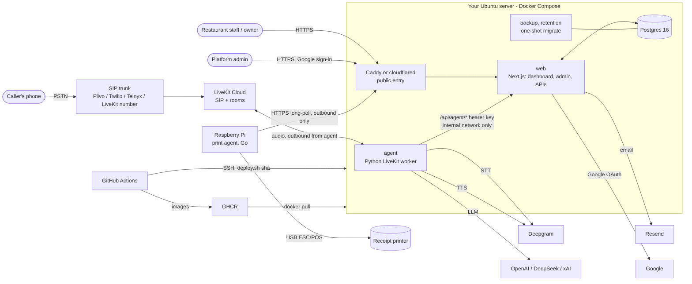
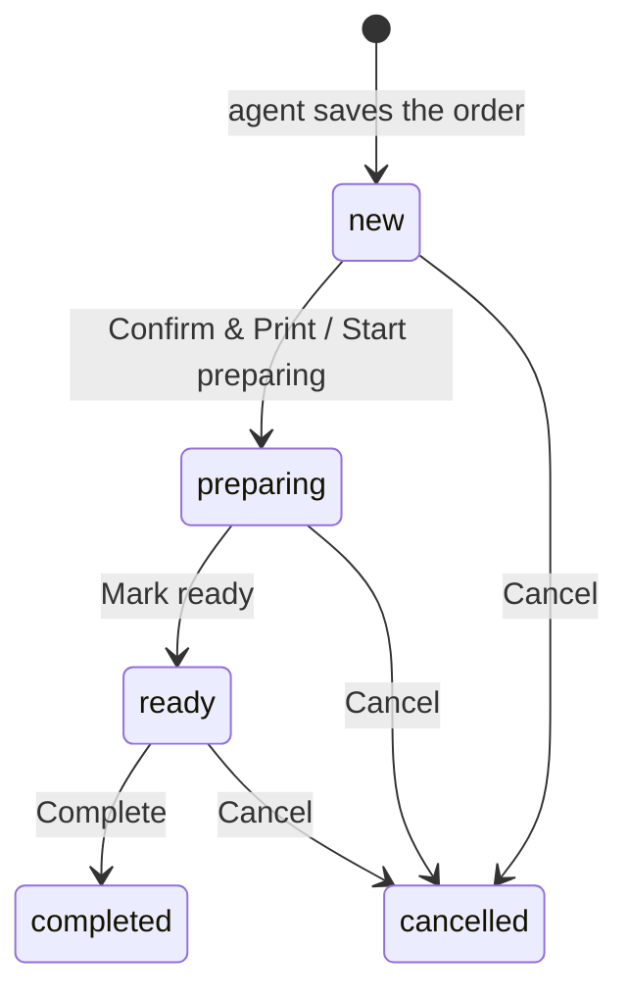
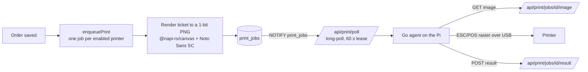
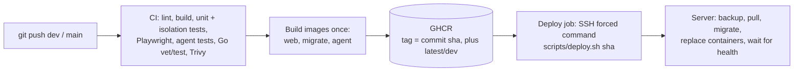

# Architecture

How the system fits together: what runs where, how a phone order becomes a kitchen ticket, how restaurants are kept
apart, and how code reaches production. For installing everything, read [SYSTEM_SETUP.md](SYSTEM_SETUP.md). Details that
live elsewhere are linked, not repeated: [DEPLOY.md](DEPLOY.md) (server and CI/CD), [PRINTER_MANUAL.md](PRINTER_MANUAL.md)
(the kitchen printer), [PRINTING_PLAN.md](../PRINTING_PLAN.md), [LAUNCH_PLAN.md](../LAUNCH_PLAN.md), [HARDENING.md](../HARDENING.md).

## 1. What the product is

A multi-tenant SaaS for restaurants. A customer phones the restaurant's number; a **voice agent** answers, takes the order
and saves it. Staff watch orders on a web **dashboard** and get a **printed ticket** in the kitchen.
A **platform admin** (us) manages restaurants, phone numbers and the AI model. Each restaurant is a tenant; nothing is shared
between tenants except the platform itself.

## 2. The big picture



Two rules shape everything:

1. **The voice agent never touches the database.** It only calls `/api/agent/*` on the web app with a shared bearer key.
   All tenant resolution, validation and persistence live in those route handlers, so isolation is enforced in one place.
2. **Everything outside the server connects outward.** The voice agent dials LiveKit, the Pi dials the web app, CI dials
   the server over SSH. No customer-site port forwarding is ever needed, and phone audio never passes through Caddy or the tunnel.

## 3. Components

| Component | Tech | Where | Responsibility |
|---|---|---|---|
| **web** | Next.js 16 App Router, TypeScript, Tailwind, React Suite (rsuite), Better Auth, Drizzle ORM | `apps/web`, container `web` | Dashboard (orders, menu, categories, modifiers, settings), platform admin, `/api/agent/*` (voice agent), `/api/print/*` (print agents), `/api/health`, auth, background jobs, hosts the print-agent downloads at `/printer/` |
| **agent** | Python, LiveKit Agents, `uv` | `apps/agent`, container `agent` | Joins the call room, runs STT -> LLM -> TTS, calls the web API as tools (menu, add item, submit order, cancel/change, transfer) |
| **db** | Postgres 16 | container `db`, volume `pgdata` | All data. Not published to the network |
| **migrate** | Drizzle migrations | container `migrate` (one-shot) | Applies migrations before `web` is replaced on every deploy |
| **worker** | Node, esbuild bundle `worker.cjs` inside the web image | container `worker` | A small separate program (no Next.js): sends the queued emails and texts with retries, the "order not acknowledged" reminders and housekeeping, so sending never slows the web app. Its `/health` endpoint fails when due jobs are not being picked up; it uses about 15 MB idle (limit 128 MB) and only the settings it uses (no auth secret) |
| **backup / retention** | shell | containers `backup`, `retention` | Daily verified dump (newest 14 kept); daily purge of caller numbers older than 90 days |
| **caddy / cloudflared** | Caddy or Cloudflare Tunnel | one of them, via `COMPOSE_PROFILES` | The single public entry point; Caddy also blocks `/api/agent/*` publicly |
| **print agent** | Go, standard library only, static binary | `apps/printer-agent`, runs on a Raspberry Pi | Pulls print jobs, prints them over USB, answers service commands, updates itself |
| **LiveKit Cloud** | SIP + media rooms | external | Receives the call from the SIP trunk, creates a room, dispatches the agent worker |
| **SIP trunk / phone number** | Plivo, Twilio, Telnyx or a LiveKit number | external | The restaurant's public number |
| **Deepgram, OpenAI, DeepSeek, xAI** | APIs | external | Speech-to-text, language model, text-to-speech. xAI "Grok" is an optional speech-to-speech mode |
| **Resend** | email API | external | Verification, password reset, new-order and cancel/change emails |
| **SMS provider** | Twilio or Plivo (optional) | external | Texts customers: the order link, a changed pickup time, a cancellation |
| **Google** | OAuth | external | Sign-in; the only way a platform admin can sign in |
| **GitHub Actions + GHCR** | CI/CD | external | Test, build images once, deploy |

Repository layout: `apps/web`, `apps/agent`, `apps/printer-agent`, `scripts/` (`deploy.sh`, `backup-db.sh`), `docker-compose.dev.yml` (local) and `docker-compose.yml` (the whole server stack; Caddyfile, backup and retention scripts are inline).

## 4. A phone call, end to end

```mermaid
sequenceDiagram
  participant C as Caller
  participant L as LiveKit (SIP)
  participant A as Voice agent
  participant W as Web API
  participant D as Postgres
  participant P as Print agent (Pi)

  C->>L: dials the restaurant's number
  L->>A: room created, agent dispatched (AGENT_NAME)
  A->>W: GET /api/agent/menu?to=<dialed number>
  W->>D: number -> tenant, suspended?, opening hours, menu + modifiers + categories
  W-->>A: menu (or closed / suspended)
  A->>W: POST /api/agent/calls (blocked number? rate limit? 3 concurrent?)
  A->>C: greeting, then asks what they would like
  loop each dish
    C->>A: asks for a dish
    A->>W: (big menus) search happens in agent memory; add_item checks choices in code
  end
  A->>C: asks pickup time (ASAP or HH:MM), reads the order back once, total computed in code
  A->>W: POST /api/agent/orders (idempotency key = call id + cart hash)
  W->>D: validate ids/prices/options server-side, allocate order number, insert order + items
  W-->>A: order number
  W->>D: enqueue print job, enqueue email (via jobs), NOTIFY
  A->>C: says the order number, offers to text the order link (if texting is on)
  A->>W: POST /api/agent/orders/sms (records the customer's number; nothing is sent yet)
  A->>C: thanks and goodbye; line is hung up
  D-->>P: NOTIFY wakes the long-poll; ticket image downloaded and printed (at once, or when staff confirm)
  W-->>W: dashboard board updates live (SSE)
  Note over W: staff press Confirm & Print / Start preparing: the order link is texted to the customer
```

Key points:

- **Tenant resolution:** the dialed number comes from the SIP attribute `sip.trunkPhoneNumber`, is looked up in
  `phone_numbers` (E.164, one agent number per restaurant) and gives the tenant. No number attached = the agent routes
  return 404 and the caller hears that orders cannot be taken.
- **The model never decides money.** Prices and names are read from `menu_items` on the server, option choices are validated
  against the groups attached to that exact dish, and totals are computed in code. Orders are idempotent, so a retry
  returns the same order number.
- **Call safety:** blocked numbers, 5 calls/hour per caller, 3 simultaneous calls per restaurant, 8-minute cap with a
  warning, silence prompts, hang-up on goodbye, and a fail-safe if the order cannot be saved (the caller is told the
  restaurant will call back and an `ALERT` line is logged).
- **Language:** English only. A scripted greeting names the restaurant, says it is an automated assistant, and asks for the
  order; speech uses Deepgram STT/TTS.
- **Big menus:** above `MENU_SEARCH_THRESHOLD` (default 40) dishes the prompt holds only an overview grouped by category,
  and the model uses a `search_menu` tool (fuzzy, ingredient words, category names).
- **Human transfer:** pressing 0 or asking for a person forwards the call (SIP REFER) to the restaurant's human line, if set.
- **LLM choice:** the platform admin picks provider and model in `/admin`; the agent reads it per call from
  `/api/agent/config`. API keys live only in the agent's environment, never in the database.
- **Grok mode (experimental):** `VOICE_MODE=grok` swaps the pipeline for xAI's speech-to-speech model with the same tools.

## 4b. After the call: confirming, texts and changes

The order is saved when the call ends. From then on the restaurant works it on the **Orders** board:



- **Confirm & Print.** With print timing set to "only after the restaurant confirms" (and a printer set up) a new order's first button reads
  **Confirm & Print**: the kitchen ticket is created only when it is pressed. With the default ("immediately") the ticket is created
  when the order is saved and the button reads **Start preparing**. Either way it is the first step out of `new`.
- **Change Pickup Time.** Active orders have a button that moves the pickup to a later time today (`orders.new_pickup_at`; the
  customer's original `pickup_at` is kept, and clearing the new time restores it). The new time is the pickup time on the board, on the
  customer's order page, on reprinted tickets and in the phone agent's order lookup.
- **Cancel.** The restaurant cancels on the board, or the customer cancels by phone (same number, order still `new`). A changed order
  that replaces the old one cancels the old one silently.

**Texts to the customer** (only if an SMS provider is configured, the restaurant's "Text messages to customers" switch is on, and the
customer gave a number during the call):

| When | Text |
|---|---|
| The restaurant confirms the order | `Thanks for your order, to view your order #N, tap this link: <domain>/orders/<token>` |
| The restaurant changes the pickup time | `Your pickup time for order #N is now 6:45 PM. Details: <link>` (one per distinct time; resetting sends nothing) |
| The order is cancelled (board or phone) | `Your order #N has been cancelled. Details: <link>` |

How the number is collected: when texting is on, the agent ends the call differently. After the order number it asks whether to text the
order details to the caller's own number or another one. A number the caller says is read back **by the system** (digit by digit, never
by the model) and needs a "yes". The agent then calls `/api/agent/orders/sms`, which re-validates the number, enforces limits (2 numbers
per order, 3 texts per destination number per day across all restaurants, order placed within 30 minutes) and only **records** it
(`orders.contact_number`). Texts are queued as `sms` jobs on the same retrying worker as email, once each (`orders.sms_sent_at` and
job de-duplication keys). The number is purged with caller numbers by the retention job.

**The order page** `/orders/[token]` is public (the 128-bit token is the only key; no sign-in), shows the order, its live status, the
pickup time, and the restaurant's address and human line (tap to map / call). It shows no customer phone numbers, is hidden from search
engines, and expires after 30 days.

## 5. From order to kitchen ticket



- The server draws the ticket as a picture, so any ESC/POS printer works and a layout change never needs
  an agent update. A job is retried up to 5 times, deduplicated per order + kind + printer, and tickets wait on the server
  while the Pi is offline.
- **When tickets are created:** at once when the order is saved, or (print timing "after the restaurant confirms") when staff press
  **Confirm & Print**. A ticket already printed is not reprinted when the pickup time changes; **Reprint** makes a new one with the new time.
- **Ticket content:** order number, pickup time (the new one, if it was changed), `Guest:` name, `Placed:` date and time, each dish with quantity, price,
  options and notes, `Total:` and `Items:` on one row. Changed and cancelled orders print banners.
- **Agent auth:** a one-time pairing code (15 min) is exchanged for a permanent `opa_...` token, stored hashed. Revoking it
  returns 401 and the agent disables itself. Restaurant code cannot read the token hash (column grants).
- **Service commands** (restart, test print, show log, update, re-detect printers, reboot, setup ticket) come from a fixed
  allow-list, never a shell, and are audited.
- **Self-update:** the Go binaries are built into the web image and served at `/printer/`; the agent checks `/api/print/update`
  ~25 s after start, then every 6 hours or on demand, verifies the sha256 over https, keeps the previous binary and rolls
  back after 3 failed starts.
- **Server address:** told to the agent once at pairing and saved in its config; it only ever calls out.
- **Printer I/O:** the agent writes to `/dev/usb/lp*` (the `usblp` driver) and waits for the transfer to finish before closing
  (a Linux quirk that otherwise truncates tickets).

More: [PRINTER_MANUAL.md](PRINTER_MANUAL.md), [apps/printer-agent/README.md](../apps/printer-agent/README.md).

## 6. Web application structure

- **Routes:** `/` sign-in; `/dashboard/{orders,menu,categories,modifiers,settings/...}`; `/admin` (+ `/admin/audit`,
  `/admin/printing`); `/api/auth/*` (Better Auth); `/api/agent/*` (voice agent, bearer key); `/api/print/*` (print agents,
  per-agent token); `/api/dashboard/orders/stream` (SSE); `/api/health`; static `/printer/*` and `/install-printer.sh`.
- **Rendering:** Next 16 with `cacheComponents`: anything reading the session sits inside `<Suspense>`. `src/proxy.ts`
  does a cheap cookie check and redirects signed-out visitors; real authorization is in `requireTenant()`,
  `requireOwner()` and `requirePlatformAdmin()`.
- **UI:** React Suite components behind thin adapters in `src/components/ui`, Tailwind for layout, light/dark/system theme,
  Roboto. Mutations are server actions that scope every query by tenant.
- **Live orders board:** a trigger on `orders` runs `pg_notify`; each web process keeps one LISTEN connection and fans events
  out over SSE, so the board and its chime update within a second.
- **Menu:** dishes, categories (many-to-many), modifier groups (reusable choices with price deltas),
  CSV import (preview, all-or-nothing) and export.
- **Background jobs** (`jobs` table, claimed with `FOR UPDATE SKIP LOCKED`; in production the dedicated `worker` container (`worker.cjs`, own entry point) runs the loop, the web
  containers have `JOB_WORKER=off`; in development every web process runs it): emails and text messages with retries
  (30 s, 2 min, 10 min, 30 min, 2 h; a failure after 5 attempts is audited), an "order not acknowledged" reminder after 5 minutes,
  and purging of old counters. Platform admins see the queue, its health and every failed job at `/admin/jobs`, and can retry or delete them.
- **First admin:** on startup, if no platform admin exists and `PLATFORM_ADMIN_PASSWORD` is set, the first email in `PLATFORM_ADMIN_EMAILS` is
  created as a verified admin (see section 8).

## 7. Data model (main tables)

| Area | Tables |
|---|---|
| Auth and tenancy | `user`, `session`, `account`, `organization` (= a restaurant), `member`, `invitation` (Better Auth) |
| Platform | `platform_settings` (LLM choice), `phone_numbers` (number -> tenant), `blocked_numbers`, `calls`, `rate_limit`, `jobs` (email and sms), `audit_logs` |
| Per restaurant | `tenant_settings` (hours, time zone, notify emails, address, human line, print timing, texting on/off, suspended), `menu_items`, `categories`, `menu_item_categories`, `modifier_groups`, `modifier_options`, `menu_item_modifier_groups`, `orders` (status; `pickup_at` and `new_pickup_at`; `caller_number`, `contact_number`, `public_token`, `sms_count`, `sms_sent_at`), `order_items` (price/name/options snapshotted) |
| Printing | `print_agents`, `printers`, `print_jobs` (ticket JSON + PNG), `print_agent_commands` |

Migrations are Drizzle SQL in `apps/web/drizzle/`. `auth-schema.ts` is generated by the Better Auth CLI and not hand-edited.

## 8. Tenancy and security

- **Tenant = Better Auth organization.** Every restaurant table has `tenant_id`; a user can own several restaurants and
  switch between them. Roles: `owner` (menu, settings, team, printing) and staff (orders board, sold-out toggle).
- **Row-level security:** dashboard actions and the agent routes run as the low-privilege Postgres role `order_app` with
  `app.tenant_id` set, so the database itself shows only that restaurant's rows (no tenant filter = no rows). `order_app`
  cannot read `audit_logs`/`jobs` or change `suspended` / phone numbers. A test fails if a table with `tenant_id` lacks RLS.
- **Platform admins** sign in with Google only (password sign-in for admin emails is rejected), their email must be verified,
  and `/admin` returns 404 to everyone else. The one exception is a brand-new system: while `PLATFORM_ADMIN_PASSWORD` is set (>= 12
  characters) the first listed email is seeded as admin with that password and may sign in with it; delete the variable once Google works. Suspended restaurants get 403 from the agent API.
- **Network:** `/api/agent/*` is blocked at the edge (Caddy rule, or a Cloudflare WAF rule in tunnel mode) and also needs
  `AGENT_API_KEY`. Security headers + CSP, 7-day sessions, auth rate limits stored in the database, HSTS.
- **Privacy:** caller numbers and the numbers customers asked us to text are masked in logs and audit entries and purged after 90 days;
  backups keep them up to 14 days. Order-page links carry an unguessable token and expire after 30 days.
- **Text abuse limits:** 2 numbers per order, 3 order texts per destination number per day, orders must be fresh (30 minutes) and not cancelled.
- **Audit log:** every mutation writes an append-only `audit_logs` row (who, which restaurant, action, before/after);
  admins browse it at `/admin/audit`.
- **Supply chain:** images pinned by digest, Actions pinned by commit, Trivy scan fails CI on fixable HIGH/CRITICAL findings.

## 9. Build, test and deploy



- **No pointless deploys:** a `changes` job compares the push with the previous commit; when only docs and tests changed (`*.md`, `docs/`,
  `LICENSE*`, test folders) the deploy job is skipped. `[deploy]` in a commit message forces one.
- **Environments:** `dev` branch -> GitHub environment `Dev` (its own server and secrets, images tagged `dev`);
  `main` -> `Prod` (also tags `latest`). Rollback = deploy an older sha.
- **The server has no repo.** It holds the compose file and `.env` (plus `scripts/` for CI deploys); the application is inside
  the images. A commit that changes those files needs them copied to the server first (see DEPLOY.md).
- **Tests:** node:test against a migrated Postgres (unit, tenant isolation, RLS, integration), Playwright browser tests,
  agent pytest (no network), Go tests with real binaries in e2e, and paid AI evals (simulated calls over text, never xAI; run on agent changes to `main`, weekly and on demand).

## 10. Operations at a glance

| Concern | How |
|---|---|
| Health | `GET /api/health` pings the database; point an uptime monitor at it |
| Logs | `docker compose logs -f web agent`; Docker log rotation is by size (10 MB x 5) |
| Backups | daily at `BACKUP_HOUR` UTC, verified, 14 kept in `./backups`; copy them off the server |
| Scaling | several `web` replicas share rate limits, jobs and the menu cache safely; `AGENT_REPLICAS` and `AGENT_MAX_CALLS` scale voice capacity; agent drains calls for up to 15 minutes on deploy |
| Queue health | the worker's `/health` and the web app's `GET /api/health/worker` (503 when a due email/text has waited > 2 min); `/admin/jobs` shows failures with their errors; failed jobs are kept 30 days |
| Failure modes | LiveKit/Deepgram/LLM down -> calls fail at connect (the agent apologises when it can); xAI out of credit -> apology or pipeline fallback; web unreachable -> the call-limit check is skipped (call allowed) but the order cannot be saved, so the caller is told the restaurant will call back and an `ALERT` is logged; Pi offline -> tickets queue |

## 11. Known gaps

Tracked in `TODO.md`, `LAUNCH_PLAN.md` and `HARDENING.md`. The main ones today: SIP transfers, more than one simultaneous
call, and the Grok mode were only tested with simulated text; off-site backups, monitoring
and error tracking, a verified Resend domain, SMS carrier registration (10DLC / toll-free) with a real provider (the Twilio and Plivo
calls were not tried against live accounts), a load test and privacy / terms pages are open owner tasks; the deployment
files still have to be copied to the server by hand.
