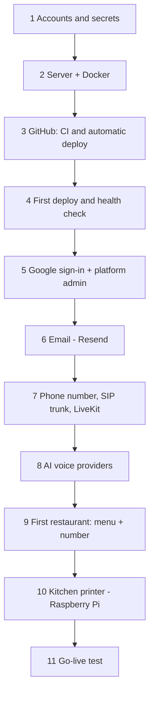

# System setup: from nothing to a working restaurant

The whole system in the order you build it: accounts, the server, GitHub deploys, sign-in, email, the phone line, the AI
voice, the first restaurant, and the kitchen printer. Each step ends with a check, so you know it works before moving on.
How the pieces relate is in [ARCHITECTURE.md](ARCHITECTURE.md). Where a step has its own detailed guide it is linked rather
than copied: [DEPLOY.md](DEPLOY.md) (server, deploys, backups), [PRINTER_MANUAL.md](PRINTER_MANUAL.md) (printer + Pi).

Commands and menu names for third-party services are written from memory and change over time: check each provider's
current docs when something does not match.

## 0. Overview and what you need



| Need | Used for | Cost note |
|---|---|---|
| A domain name | the public address of the dashboard | yearly fee |
| An Ubuntu 22.04/24.04 server, about 2 GB RAM, Docker | runs web, voice agent, database | any VPS or your own machine |
| GitHub repo (private is fine) | code, CI, image registry (GHCR) | free tier works |
| Cloudflare account (only for tunnel mode) | no open ports, hides the server IP | free |
| Google Cloud project | OAuth sign-in | free |
| Resend account + a domain you can add DNS records to | email | free tier |
| LiveKit Cloud project | phone calls (SIP) and audio rooms | usage based |
| A phone number from a SIP provider (Plivo, Twilio, Telnyx) or a LiveKit number | the restaurant's number | monthly + per minute |
| Deepgram, OpenAI (and/or DeepSeek) API keys | speech-to-text, LLM | usage based. xAI only if you use Grok mode |
| Per restaurant: Raspberry Pi 3/4/5/Zero 2 W + microSD + USB ESC/POS receipt printer + paper | kitchen tickets | one-off |

Set spending alerts at OpenAI, Deepgram, LiveKit and your SIP provider before going live.

## 1. Accounts and secrets

Generate every secret fresh for production (never reuse development values):

```
openssl rand -hex 32     # run once per secret: BETTER_AUTH_SECRET, AGENT_API_KEY, POSTGRES_PASSWORD
```

Keep a password manager entry for each of: the three secrets above, the LiveKit key/secret, Deepgram, OpenAI/DeepSeek,
Resend and Google OAuth credentials, the GHCR read token, the Cloudflare tunnel token (tunnel mode), the CI deploy key.
`.env` holds them on the server (`chmod 600`, never committed).

## 2. The server

Everything runs in Docker Compose on one machine (web, agent, database, backups, and either Caddy or a Cloudflare tunnel).

1. Install Docker Engine and the Compose plugin from Docker's apt repository, then add your deploy user to the `docker`
   group (a dedicated user such as `deploy` is recommended) and log in again.
2. Choose how traffic reaches the server:

   | | `COMPOSE_PROFILES=caddy` | `COMPOSE_PROFILES=tunnel` |
   |---|---|---|
   | Needs | public IP, ports 80/443, a DNS **A record** to the server | a domain on Cloudflare |
   | TLS | Caddy + Let's Encrypt | Cloudflare |
   | Works behind home/office NAT | no | yes |
   | Hide `/api/agent/*` from the internet | automatic (Caddyfile) | **you must add a WAF rule**: URI path starts with `/api/agent` -> Block |

   Print agents and the dashboard use `/api/print/*`, `/printer/*` and `/install-printer.sh`: these must stay public.
3. Firewall (caddy mode): allow SSH, 80 and 443 only. In tunnel mode allow SSH only. Never add `ports:` to `db` or `web`.
4. Create the folder and copy the deployment files from the repo root on your machine (the server never clones the repo):
   ```
   ssh you@server 'sudo mkdir -p /opt/quick-assistant && sudo chown $USER /opt/quick-assistant'
   rsync -av --relative docker-compose.yml scripts/ you@server:/opt/quick-assistant/
   ssh you@server 'cd /opt/quick-assistant && chmod +x scripts/*.sh'
   ```
   Repeat the `rsync` whenever a commit changes `docker-compose.yml` or `scripts/`.
5. Create `/opt/quick-assistant/.env` from `.env.prod.example` (see the variable table in section 4) and `chmod 600` it.
6. Let the server pull your private images (one time, as the deploy user), with a GitHub token that has only `read:packages`:
   ```
   echo <token> | docker login ghcr.io -u <github-user> --password-stdin
   ```

Check: `docker compose version` works, `ls /opt/quick-assistant` shows the compose file, `scripts/`, `.env`.

## 3. GitHub: CI and automatic deploys

CI (`.github/workflows/ci.yml`) lints, builds and tests everything, builds the images **once**, pushes them to GHCR as
`$IMAGE_PREFIX/{web,migrate,agent}:<commit sha>`, and then deploys by SSH.

| Branch | GitHub environment | Server | Image tag |
|---|---|---|---|
| `dev` | `Dev` | your test server | `dev` |
| `main` | `Prod` | production server | `latest` |

1. Create the two environments (Settings -> Environments). Each gets its **own** secrets:

   | Secret | Value |
   |---|---|
   | `DEPLOY_HOST`, `DEPLOY_USER` | server address and the deploy user |
   | `DEPLOY_PATH` | `/opt/quick-assistant` |
   | `DEPLOY_SSH_KEY` *or* `DEPLOY_PASSWORD` | a CI-only private key (recommended) or the user's password |
   | `DEPLOY_FINGERPRINT` | the server's host key fingerprint, `SHA256:...`. The action checks the **first** key the server offers, which is usually **ECDSA**: `ssh-keyscan -t ecdsa <host> \| ssh-keygen -lf -` shows it |
   | `DEPLOY_URL` | `https://<DOMAIN>` (CI calls `/api/health` after deploying) |
   | `DEPLOY_PORT` | only if SSH is not on 22 |

2. Restrict the CI key on the server to the deploy script, in the deploy user's `~/.ssh/authorized_keys`:
   ```
   restrict,command="/opt/quick-assistant/scripts/deploy.sh" ssh-ed25519 AAAA... ci-deploy
   ```
3. Require reviewers on `Prod` if you want a manual gate. With no deploy secrets the deploy job simply skips itself.

GitHub's servers must reach the server on SSH. A server behind NAT cannot be reached; deploy by hand there
(`ssh server /opt/quick-assistant/scripts/deploy.sh <sha|latest|dev>`).

Check: push to `dev`; the `build-image` jobs go green, then `Deploy`.

## 4. First deploy and configuration

`.env` variables (full list and comments in `.env.prod.example` and `.env.example`):

| Variable | Meaning |
|---|---|
| `DOMAIN` | public hostname without scheme, e.g. `app.example.com` |
| `COMPOSE_PROFILES` | `caddy` or `tunnel` |
| `CLOUDFLARE_TUNNEL_TOKEN` | tunnel mode only |
| `IMAGE_PREFIX` | `ghcr.io/<owner>/<repo>`, lowercase |
| `POSTGRES_PASSWORD`, `BETTER_AUTH_SECRET`, `AGENT_API_KEY` | the generated secrets (`POSTGRES_PASSWORD` only applies when the database is first created) |
| `BETTER_AUTH_URL` | must be the public address (`https://<DOMAIN>`); it is also what print agents are told |
| `PLATFORM_ADMIN_EMAILS` | comma-separated emails that become platform admins (Google sign-in only) |
| `GOOGLE_CLIENT_ID`, `GOOGLE_CLIENT_SECRET` | section 5 |
| `RESEND_API_KEY`, `EMAIL_FROM` | section 6 |
| `LIVEKIT_URL`, `LIVEKIT_API_KEY`, `LIVEKIT_API_SECRET`, `AGENT_NAME` | section 7 |
| `DEEPGRAM_API_KEY`, `OPENAI_API_KEY`, `DEEPSEEK_API_KEY` | section 8 (at least one LLM key) |
| `VOICE_MODE`, `XAI_API_KEY` | `pipeline` (default) or the experimental `grok` mode |
| `SMS_PROVIDER`, `SMS_FROM`, `TWILIO_*` / `PLIVO_*` | optional: text customers a link to their order (section 8b). Empty = off |
| `AUTH_IP_HEADER` | `cf-connecting-ip` behind Cloudflare, else leave the default |
| `BACKUP_HOUR`, `BACKUP_KEEP`, `RETENTION_CALLER_DAYS` | optional tuning |
| `JOB_TICK_SECONDS` | optional: how often the worker looks for due emails/texts (compose default 2) |
| `AGENT_REPLICAS`, `AGENT_MAX_CALLS` | voice capacity (see DEPLOY.md, "Scaling the voice agent") |

Compose refuses to start when a required variable is missing.

Deploy: push to `dev` / `main`, or by hand on the server `./scripts/deploy.sh latest` (or `dev`, or a full sha). The script
takes a backup, pulls the images, runs migrations, replaces the containers and waits for health.

Check: `curl https://<DOMAIN>/api/health` returns `{"ok":true}`, and `docker compose ps` shows everything running.
Tip: `export COMPOSE_FILE=docker-compose.yml COMPOSE_ENV_FILES=.env` shortens read-only commands.
In tunnel mode also confirm the connector is healthy in the Cloudflare dashboard.

## 5. Google sign-in and the platform admin

1. Google Cloud Console -> APIs & Services -> Credentials -> OAuth client (Web application):
   - Authorized JavaScript origin: `https://<DOMAIN>`
   - Redirect URI: `https://<DOMAIN>/api/auth/callback/google`
2. Put the client id/secret in `.env`, restart (`docker compose up -d` with the same `IMAGE_TAG`, or re-run `deploy.sh`).
3. Publish the consent screen before launch (otherwise only listed test users can sign in).
4. Sign in with Google using an email listed in `PLATFORM_ADMIN_EMAILS`. That account becomes a platform admin and
   `/admin` opens for it. There is **no password** for admins. Turn on 2-step verification on those Google accounts.

**No Google account, or Google not set up yet?** Seed the first admin with a password instead, on a brand-new system:
1. In `.env` set `PLATFORM_ADMIN_EMAILS=you@example.com` and `PLATFORM_ADMIN_PASSWORD=<at least 12 characters>`.
2. Deploy. On startup, if no platform admin exists yet, the first listed email is created as a verified admin with that password
   (the web log shows `[bootstrap] platform admin ... created`).
3. Sign in at `/` with that email and password, and open `/admin`.
4. Set up Google sign-in when you can, then **delete `PLATFORM_ADMIN_PASSWORD` from `.env` and redeploy**. Password sign-in for admins
   only works while the variable is set, so this puts the system back to Google-only admins (turn on 2-step verification there).
It never changes an account that already exists with that email, and it does nothing once any admin exists.

Check: `/admin` shows the restaurants list; a non-admin account gets a 404 there.

## 6. Email (Resend)

Add and verify your sending domain at Resend (add the DNS records they give you; keep them **DNS only** if the domain is on
Cloudflare), create an API key, set `RESEND_API_KEY` and `EMAIL_FROM` (e.g. `Quick Assistant <orders@yourdomain.com>`), redeploy.
Until this is done nobody receives verification, reset or new-order emails: they only appear in `docker compose logs web`.

Check: sign up with an email and password; the verification email arrives.

## 7. Phone number, SIP trunk and LiveKit

A call flows: caller -> SIP provider -> LiveKit SIP -> a LiveKit room -> your voice agent joins it.

1. **LiveKit Cloud:** create a project; put `LIVEKIT_URL` (`wss://...livekit.cloud`), key and secret into `.env`.
2. **A number.** Either buy one in LiveKit, or use your own trunk (needed if you want **call transfer** to a human: LiveKit-purchased
   numbers cannot do SIP REFER). Example with Plivo (check Plivo's and LiveKit's current docs):
   - In the provider, create a SIP trunk whose **origination URI** points to your LiveKit project's SIP address (shown in the
     LiveKit dashboard), with `;transport=tcp` if required, and route your number to that trunk.
   - In LiveKit create an **inbound trunk** listing the number(s) in E.164 form (`+14155550123`).
   - Create a **dispatch rule** that makes a room per caller and names your agent: its agent name must equal `AGENT_NAME`
     in `.env` (the project uses `food`). Create/inspect them with the `lk` CLI (`lk sip inbound list`,
     `lk sip dispatch list`; needs `LIVEKIT_URL`, `LIVEKIT_API_KEY`, `LIVEKIT_API_SECRET` in the environment).
   - If the dispatch rule names an agent and the worker registers without a name (or the reverse), calls ring but nobody answers.
3. **Attach the number to the restaurant** (section 9): the platform admin does this in `/admin`; restaurants see it read-only.
   It must be saved in E.164 and equal the number LiveKit reports as `sip.trunkPhoneNumber`.
4. Optional **human line**: the owner sets a number in Settings; pressing 0 on the call forwards to it.

Check: call the number. `docker compose logs agent` shows the call joining with `participant attributes: {...}` including the
dialed number. If the caller hears "we cannot take your order right now", see the troubleshooting table.

## 8. AI voice providers

| Key | Used for |
|---|---|
| `DEEPGRAM_API_KEY` | speech-to-text and the voice |
| `OPENAI_API_KEY` | the default language model |
| `DEEPSEEK_API_KEY` | alternative language model |
| `XAI_API_KEY` | only for `VOICE_MODE=grok` (experimental speech-to-speech; verify credit with the xAI key-info endpoint first) |

The platform admin chooses the provider and model in `/admin` (saved in the database, never the API keys). Keys come from the
agent's environment only. Restart the agent after changing keys.

Check: on a test call the agent greets, asks for your order, and answers. Put spending alerts on every provider.

## 8b. Text messages to customers (optional)

After an order the phone agent can offer to text the customer a link to it: "Thanks for your order, to view your order #7, tap this
link: https://<DOMAIN>/orders/<token>". Set up a texting provider:

1. Choose `SMS_PROVIDER=twilio` (needs `TWILIO_ACCOUNT_SID`, `TWILIO_AUTH_TOKEN`, `SMS_FROM` = a Twilio number or messaging service `MG...`)
   or `plivo` (`PLIVO_AUTH_ID`, `PLIVO_AUTH_TOKEN`, `SMS_FROM`). `SMS_PROVIDER=log` only prints messages to `docker compose logs web` (testing).
2. **US numbers must be registered with the carriers** (A2P 10DLC for local numbers, or a verified toll-free number) or messages are blocked.
3. Redeploy. Each restaurant can turn it off under Settings -> Notifications ("Text messages to customers"). Without a provider the
   agent never offers it.

Customers who gave a number are texted three things: the order link when the restaurant **confirms** the order, a new time when the
restaurant uses **Change Pickup Time** on the order card, and a notice when the order is **cancelled**. The first is sent when the restaurant **confirms** the order on the board (the first button on a new order: Confirm & Print, or Start
preparing). An order nobody confirms, or that is cancelled first, is never texted. The page also shows the restaurant's address and human
line (set in Settings), so keep those filled in.

Check: with `SMS_PROVIDER=log`, place a test order, say yes to the text, press the order's first button on the board, and see the message in
the web log; the order card then shows "Order link texted to +1...". Limits: 2 numbers per order, 3 texts per destination number per day; the
link works for 30 days.

## 9. First restaurant

1. A restaurant owner signs up (Google or email + password) and creates the restaurant at onboarding (or the admin creates it).
2. Platform admin, in `/admin`: attach the restaurant's phone number (E.164). Without it, the agent API returns 404 and callers hear that
   orders cannot be taken.
3. Owner, in the dashboard:
   - **Menu:** add dishes (name, description, price) or **Import CSV** (preview first; nothing is deleted);
     **Categories** (a dish can be in several); **Modifiers** (reusable choices such as size or spice, with price changes).
   - **Settings:** time zone and opening hours (outside them the agent states the hours and hangs up), address, notification
     emails, human line, team (invite staff by email; staff can use the orders board and mark dishes sold out).
4. Optional: suspend or limit tenants and block numbers from `/admin`; browse everything that happened in `/admin/audit`.

Check: call the number, order a dish; the order appears on the **Orders** board with a chime, and the notification email arrives.

### A chain with several locations
Create **one restaurant per location**, each with its own phone number (attached by the platform admin), address, hours, human line,
staff and printer. The same owner can own all of them and switch with the restaurant switcher. To share a menu, build it in the first
restaurant, then in the others press **Menu -> Copy from another restaurant**: it copies dishes, categories, modifier groups and their
links (matched by name, nothing deleted, with a preview first). Choose "also update dishes I already have" to pull later price changes
across. Name the restaurants clearly ("Yifan - Johns Creek"): the name is spoken to callers and shown on texts and the order page.

## 10. Kitchen printer (Raspberry Pi)

Hardware: a Raspberry Pi (3, 4, 5 or Zero 2 W), power supply that can really deliver 2.5 A or more (a weak supply causes the
low-voltage warning and garbled prints), a 16 GB+ microSD card, a USB ESC/POS receipt printer (80 mm or 58 mm), thermal paper,
a network cable (or Wi-Fi details).

**No monitor needed.** Short version (details and troubleshooting in [PRINTER_MANUAL.md](PRINTER_MANUAL.md)):

1. Flash **Raspberry Pi OS Lite (Trixie)** with Raspberry Pi Imager, answering **No** to customisation.
2. Owner -> **Settings -> Kitchen printing -> Set up a new Pi without a monitor**: fill in a name, host name, Wi-Fi (leave empty
   for a cable) and optionally an engineer's SSH public key. Click **Create setup files**, then click **each** download button.
   The files must be named exactly `user-data` and `network-config` (no `.txt`).
3. Copy them onto the card's `bootfs` drive, replacing the existing files. The pairing code inside is valid for 7 days.
4. Insert the card, connect the printer (on, paper loaded) and the network, power on. In about 5 minutes the agent shows
   **Online** in the dashboard and the printer prints a test ticket.

How it finds the server: the files contain your server address and a one-time code. On first boot the Pi downloads
`/install-printer.sh` from the server, installs the agent as a service, and pairs it. The address is then stored on the Pi and the
agent only ever connects out to it. If you ever change the domain, pair the Pi again.

Other facts to know:
- The agent updates itself from your server (`/printer/`); a new agent version is released by bumping `apps/printer-agent/VERSION`
  and deploying the web image. Check the version on a test slip or in the agent's card.
- Set **paper width** and the printer **On** switch on the printer row; **Test print**, **Re-detect printers**, **Reprint** an order.
- SSH into the Pi only if you pasted a public key; otherwise manage it from the dashboard's Service buttons.

Check: **Test print** works, then a real phone order prints within seconds and shows **Printed** on the board.

## 11. Go-live test

- [ ] `https://<DOMAIN>/api/health` returns `{"ok":true}`; HTTPS works; `/api/agent/*` is **not** reachable from the internet
- [ ] A platform admin can sign in with Google; a normal user gets a 404 on `/admin`
- [ ] Verification and new-order emails arrive
- [ ] A real call from a mobile phone: ordering with options, pickup time, read-back, order number, goodbye
- [ ] The order shows on the board with a chime, and a ticket prints with the right prices, name and pickup time
- [ ] Cancel and change by phone work from the same number; a call outside opening hours gets the hours message
- [ ] Human transfer works (needs a trunk that supports transfers) or is switched off
- [ ] A backup exists in `./backups` and has been **copied off the server**; one restore was practised
- [ ] An uptime monitor watches `/api/health`; provider spending alerts are set; secrets differ from dev
- [ ] Privacy policy and terms published; call-recording / AI disclosure wording reviewed for your regions

## 12. Day-to-day operations

| Task | How |
|---|---|
| Deploy | push to `dev` / `main`, or `./scripts/deploy.sh <sha\|latest\|dev>` on the server |
| Roll back | `./scripts/deploy.sh <older full sha>` (database migrations are not undone) |
| Logs | `docker compose logs -f web agent`; `docker compose logs backup` |
| Backup now | `./scripts/backup-db.sh`; restore command is in DEPLOY.md ("Operating it") |
| Update server files | `rsync` again when a commit changes `docker-compose.yml` or `scripts/` |
| Never | `docker compose down -v` (deletes the database volume); run bare `docker compose up` for updates (use `deploy.sh`) |
| Scale calls | raise `AGENT_REPLICAS` / `AGENT_MAX_CALLS`; several `web` replicas are supported |

## 13. Troubleshooting

| Symptom | Likely cause | Where to look / fix |
|---|---|---|
| Caller hears "we cannot take your order by phone right now" | the dialed number is not attached to a restaurant, the restaurant is suspended, it is outside opening hours, or the web API is unreachable | `/admin` number list; `docker compose logs agent`; opening hours; `AGENT_API_KEY` identical in web and agent |
| Call rings but no agent answers | agent name mismatch between the LiveKit dispatch rule and `AGENT_NAME`, or the agent container is down | `lk sip dispatch list`; `docker compose ps agent` |
| Agent answers but cannot hear / speak | missing or invalid Deepgram / OpenAI key, provider out of credit | agent logs; provider dashboards |
| Calls refused for your own testing number | per-caller hourly limit (5) | raise `MAX_CALLS_PER_CALLER_PER_HOUR` while testing |
| No emails | Resend not configured or domain unverified | `docker compose logs web` shows the links instead |
| Google sign-in fails | redirect URI mismatch, consent screen in Testing, `BETTER_AUTH_URL` wrong | Google console; `.env` |
| CI deploy: `host key fingerprint mismatch` | pinned the wrong key type | use the **ECDSA** fingerprint (section 3) |
| CI deploy cannot connect | server behind NAT or SSH closed to GitHub | deploy by hand, or use a self-hosted runner |
| `deploy.sh` says an image is not found | CI has not pushed that sha yet, or the server is not logged in to GHCR | check Actions; `docker login ghcr.io` |
| No **Confirm & Print** button on an order card | the setting is still "Immediately", the restaurant has no printer row, or the order is no longer new | Settings -> Kitchen printing: choose "Only after the restaurant confirms it" and save; add a printer |
| Emails / texts stop going out | the `worker` container is down or stuck | `docker compose ps worker` and `docker compose logs worker`; the web app's `/api/health/worker` returns 503; `/admin/jobs` shows the lag; restart it with `docker compose restart worker` |
| Messages in the Failed list at `/admin/jobs` | the provider refused them (key, credit, unverified sender, bad number) | read the error on the row, fix the cause, then **Retry** (or **Delete** a text to a number that can never work) |
| Customer was not texted | no SMS provider (`SMS_PROVIDER`), the restaurant's "Text messages to customers" switch is off, the customer gave no number on the call, or the order was never confirmed | check the order card ("Customer's number ..."), Settings -> Notifications, `docker compose logs web` (`[sms]` lines), `system.job_failed` entries in `/admin/audit` |
| Texts are sent but never arrive (US) | the sending number is not registered with the carriers | register A2P 10DLC or verify a toll-free number at your SMS provider |
| Pickup change did not text the customer | same reasons as above; a repeated save of the same time sends nothing | the success message says whether the customer was texted |
| Raspberry Pi: agent **Offline** | no power, cable or Wi-Fi | PRINTER_MANUAL section 6 |
| Pi: low-voltage warning, garbled tickets | weak power supply | use a 2.5 A+ supply; agent 0.1.2+ for the USB truncation fix |
| Ticket missing prices or old layout | ticket was created before the layout change | new orders use the current layout; reprints of old orders keep old data |
| Pi stuck "Waiting to pair" | code expired (15 min) or typed wrong | new pairing code, run the command again |
| Whole site down after a deploy | the new web container never became healthy | `deploy.sh` prints the web logs and the rollback command |

Further reading: [DEPLOY.md](DEPLOY.md), [PRINTER_MANUAL.md](PRINTER_MANUAL.md), [ARCHITECTURE.md](ARCHITECTURE.md),
[LAUNCH_PLAN.md](../LAUNCH_PLAN.md) (the ordered go-live gate), [HARDENING.md](../HARDENING.md), and `CLAUDE.md` for the detailed
design rules.
